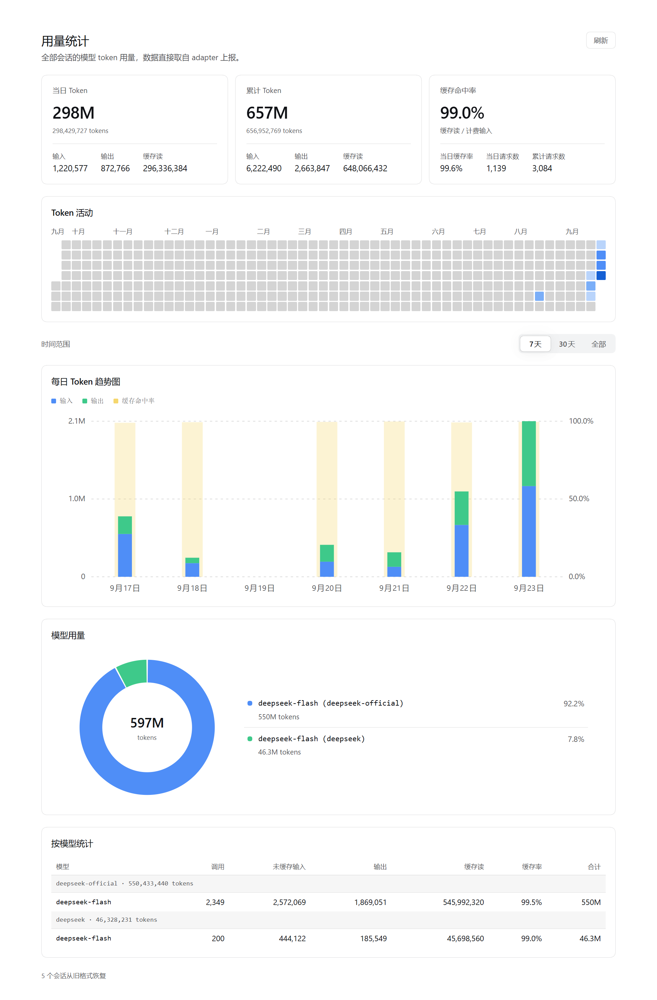

# dsh-plugin-usage-stats

Whole-corpus token usage statistics for [DeepSeek Harness](https://github.com/deepseek-ai) (DSH): a sidebar entry plus the full-page dashboard it opens. It reads the session logs DSH already writes and answers exactly one question — how many tokens did all of these conversations use?



中文简介：跨全部会话的 token 用量统计插件。在 DSH Web GUI 左侧栏新增「用量统计」入口，主区域打开整页仪表盘；只读本地会话日志，不上传任何数据。

## One job

The plugin answers one question: how many tokens did these sessions use. Nothing else.

- **No settings.** Install and use. No config file, no tunables. The only controls are a Refresh button and a 7-day / 30-day / All range switch.
- **No estimates.** Every number comes straight from the `usage` the adapter reported. No inference, no word-count conversion, no padding.
- **Nothing model-visible.** It registers no tool, injects no prompt, and modifies no request. The model cannot see it, and it cannot affect prompts or the KV cache.
- **Single purpose.** One entry, one full page, one read-only route (`GET /api/usage-statistics.data`). Every view shares the same payload and the same time window, so a chart and a table can never disagree about their range.
- **No runtime dependencies.** The Host half is plain Node modules; the browser half is a browser-loadable bundle. No build step and no third-party runtime dependencies.

## Features

The page is a single full-page report. The only controls are the page-level Refresh button and a 7-day / 30-day / All range switch; the switch changes the view window only, never the payload or the counting rules, so nothing is silently filtered out. It sits on its own row and drives the three views below it, which always share one window.

- **Summary cards** — today's and cumulative tokens (each split into input, output, and cache read), plus cache hit rate with today's cache rate and today's / cumulative request counts.
- **Token activity** — a year-long daily heatmap in a GitHub-style four-step blue scale. Month labels are placed by actual rendered width and dropped when they would collide; hovering any cell shows all metrics for that day.
- **Daily token trend** — stacked bars (input + output) with a wider pale-yellow hit-rate bar on the right axis (0–100%), drawn as the background of that day's stack.
- **Model usage ring** — a ring chart with a legend (model name, share, token count). Hovering a slice or a legend row shows share, calls, and cache rate; narrow cards fall back to a stacked single column.
- **Per-model table** — grouped by provider with model, calls, uncached input, output, cache read, cache rate, and total. The table scrolls internally with a sticky header.
- **K/M/B hover readouts** — token values in heatmap tooltips and trend bars are abbreviated (`698.9M`), because a day's usage routinely reaches hundreds of millions and a raw number is unreadable in a tooltip. Calls stay integers (they are counts, not magnitudes) and cache rates stay percentages. Exact values remain available in the summary card notes and the per-model table.

"All" means the corpus's own span: with only 7-day and 30-day options, any model used earlier would disappear from the ring and the table forever.

The full page shares the plugins page width (a centered 960 px column).

## Data source and privacy

The plugin reads the session logs DSH persists under `<DSH_HOME>/sessions` (`session.v*.jsonl.zstd`, multi-frame zstd JSONL) and folds two event types:

```jsonc
// assistant/message — the settlement, the only source of token counts
{
  "usage": { "inputTokens": 0, "outputTokens": 0, "cacheReadTokens": 0, "cacheWriteTokens": 0 }
}
```

The counts do not overlap: `inputTokens` is uncached input only, and billed input is the sum of the three. Model attribution comes from the most recent `request/header` (or `request/context`) before the settlement, reading `config.provider` / `config.model`.

The route is `GET /api/usage-statistics.data?days=<7..1100>`, defaulting to 371 days (one year of heatmap). `days` is a floor, not a cap: when the corpus is older, the window widens back to the corpus start so early models stay listable. It is served over DSH's shared `/api` channel and is therefore only reachable from an authenticated browser session.

The heatmap and the trend use two windows: `payload.days` (heatmap) always covers the whole requested window, while `payload.trend.days` (trend / ring / table) starts at the corpus's first day. The heatmap keeps a year of context without padding the trend with months of empty columns.

**Privacy.** Nothing leaves the machine. The plugin makes no network requests, sends no telemetry, and uploads nothing; all numbers are derived and rendered locally by the DSH Web GUI. The only file it writes is the derived checkpoint described below, and it holds token aggregates, per-session cursors, the last route (provider/model strings), and each log's file size and mtime — never message content.

## Incremental start (checkpoint)

A cold start reads every session log. Measured on a real store, that pass costs about 2 s, 99% of it zstd decompression plus JSON parsing (73 sessions, ~51 MiB of compressed frames, 48k events); folding the parsed events takes about 12 ms and stat-ing every artifact about 6 ms. Reading is the cost — folding less would save nothing.

The plugin therefore keeps a **derived checkpoint** at `<DSH_HOME>/storages/usage-stats/ledger.json`: the folded aggregate, plus each session's cursor, last known route, and an artifact fingerprint (size + mtime). On restart:

- A session whose size and mtime are unchanged is **not read at all**; the live feed owns it from the cursor the checkpoint restored.
- A session whose log moved is re-read and folded only past its cursor.
- Measured on the same corpus: a checkpointed start takes ~33 ms instead of ~1.5 s (≈46×), with every total identical line by line.

The checkpoint is a **pure cache**: every field can be recomputed from the logs, so invalidation is blunt and always safe. A rejected file just means a full fold — slower, never wrong. It is discarded when:

- the file format version, the fold version (`FOLD_VERSION` — bumped whenever a fold or attribution change would alter a cold result), or the host timezone offset does not match;
- the corpus no longer contains every session the checkpoint folded (a folded aggregate cannot subtract one session, so it is rebuilt).

Writes are atomic (temporary file + rename) and only happen when the in-memory state differs from disk. Live settlements are flushed on a 2 s debounce; losing one merely costs the next start a re-read. Enumeration failure throws before the write, so a corpus that was never fully listed is never stored as complete. Two processes racing write last-wins, and a lost write is again only a cache miss. `DSH_USAGE_STATS_STATE` overrides the state directory — tests and replay scripts point it at a throwaway path so they never touch a real host's cache.

## Corpus failure warning

Enumeration can fail (`sessionQuery.listSessions()` throws). The payload then carries `warnings.corpusFailures` and the panel shows an explanation. This flag cannot be inferred from the other counters: with enumeration down nothing is folded, every counter legitimately reads 0, and the live feed refuses every session because ownership cannot be decided — so the page would render "not read" as "no usage". The failure is retried on the next request; once an attempt succeeds, the flag and its reason are removed together.

## Correctness rules

- **Exactly-once attribution.** The cold scan and the live feed partition sessions between them: a session the scan listed belongs to the scan (it reads the whole log, and live events wait for the cursor the scan leaves behind), while a session the scan never listed has no other contributor and is adopted by the feed from its first event. Before the scan has enumerated anything the two cases are indistinguishable, so nothing is claimed until it has. A session the scan cannot read is released to the live feed.
- **Fork de-duplication.** A forked child session's log begins as a copy of its parent's prefix. The plugin cuts at the `session/end-seed` marked `inherited: true`, so the parent's tokens are not counted twice. A `session/end-seed` without that label is an ordinary lifecycle boundary and is not used as a cut point.
- **Routes survive the restart.** `request/header` is a *change record*, not a per-request one: a session that keeps running on the same route writes no new header. The scan therefore hands each session's last route to the live feed. Without it, every settlement the session produces after the scan would fall into the `unknown` fallback route — a phantom `unknown` model in the ring carrying real tokens. The stored route only fills a gap; it never overrides a route the live feed actually saw. A session whose log names no route at all still reports `unknown`, which is the honest fallback rather than a bug.
- **Legacy (v0) recovery.** Where the migration layer refuses a v0 archive, the plugin reads the settlements directly out of the archive and reports them as `recoveredSessions`. The scan runs once per process, and unreadable sessions go into a permanent set, so the failure counter does not grow on every poll.
- **Two heatmap/trend windows.** `buildPayload` keeps them separate: merging them would either drop the heatmap's context or pad the trend with empty columns. Change both deliberately.
- **Local time.** Day boundaries use the host's local timezone offset, captured once per process; the browser does not infer it. Persistent log timestamps use `time`, and the offset sign convention is east-positive.

## Install

The plugin is a DSH profile bundle with a Host half (`index.js`, via `cordis.patch.yml`) and a browser half (`client.js`). Install it by adding it to a profile and enabling it there.

1. Add the package as a dependency in the profile's `package.json` (typically `<DSH_HOME>/profiles/<profile>/package.json`), pointing at its directory inside the `dsh-plugins` monorepo — `link:` and `file:` both work; adjust the relative path for your layout:

   ```jsonc
   {
     "dependencies": {
       "dsh-plugin-usage-stats": "link:../../dsh-plugins/packages/usage-stats"
     }
   }
   ```

2. Register it as a profile bundle in the same file:

   ```jsonc
   {
     "dsh": {
       "profile": {
         "bundles": ["dsh-plugin-usage-stats"]
       }
     }
   }
   ```

3. Restart DSH (or reload the profile), then **reload the browser window**. A newly installed client bundle is picked up on the next page load. Restart the Host before refreshing the page; the other order briefly pairs the new front end with the old Host.

No runtime dependency needs installing. The Host half is plain Node ESM and the browser half is a plain JavaScript bundle — there is no build step.

中文提示：在 profile 的 `package.json` 中把本目录以 `link:`（或 `file:`）加入 `dependencies`，并在 `dsh.profile.bundles` 中追加 `"dsh-plugin-usage-stats"`，重启 DSH 后刷新页面即可。

### Client requirements

The browser half is declared in `package.json`:

```jsonc
"dsh": {
  "bundle": { "patch": "./cordis.patch.yml" },
  "client": {
    "platform": "web",
    "immediately": true,
    "inject": [
      "@deepseek-ai/dsh-client-ui-layout",
      "@deepseek-ai/dsh-client-ui-sidebar"
    ]
  }
}
```

Those `@deepseek-ai/dsh-client-ui-*` packages must be present in the Web client's module table: they provide the sidebar slot this entry mounts into and the layout the full page opens in. The browser half injects only those two services.

## Development

```bash
node --test "test/*.test.js"   # or: npm test
```

The suite is fully synthetic: every case carries its own fixture (fixed timezone offset and fixed dates), so it never reads the local corpus and gives the same result on another machine or a week later. **Every Host-side test file must `import './support/isolated-state.js'` before activating the plugin** — it points the checkpoint at a throwaway directory. Without it a test run would write into a real `~/.dsh/storages/usage-stats`, and the next real start could adopt a checkpoint built from fixtures. That failure is silent and delayed (the offending test does not fail), which is why it lives in one shared module instead of one line per file.

To run one real-corpus smoke case on top of the synthetic ones:

```bash
USAGE_STATS_REAL_LOGS=1 npm test            # bash
$env:USAGE_STATS_REAL_LOGS = "1"; npm test  # PowerShell
```

That case asserts only properties that hold for any corpus (every view renders, no pre-opened tooltip, ring and table agree on the model count); it skips itself when the store is empty or has a single route. Real data is valuable because its shapes are unexpected: odd `cwd` values, sparse months, v0 archives, model names fixtures never contain.

### Verify scripts

`verify/` reads the real store at `<DSH_HOME>/sessions` and checks the implementation against measured data rather than documentation assumptions. They need a real corpus, so they are not part of `npm test`.

| Script | What it does |
| --- | --- |
| `npm run verify:logs` | Folds the real store once and prints the field shapes actually observed. |
| `npm run verify:cut` | Compares fork cut-point strategies. |
| `npm run verify:payload` | Checks the payload's invariants. |
| `npm run verify:read` | Tries every session and locates the real cause of `sessionsFailed`. |
| `npm run verify:v0` | Counts recoverable usage in v0 archives the migration layer rejects. |
| `npm run verify:corpus` | Scans the whole corpus twice to prove counters are idempotent. |
| `npm run verify:trend` | Prints input/output/cache-read and hit rate at the trend's granularity. |
| `npm run verify:replay` | Replays a day: cold scan at a cutoff time, then live folding after it, and reconciles the daily totals. Also checks the fallback route and exits non-zero if any token lands in `unknown`. |
| `npm run verify:gain` | Runs a cold and a checkpointed start on the real corpus and prints logs read, speedup, and whether both totals match. |

`verify:replay` takes the scan time as an argument (default 09:30 today). It reads the log **as it was at that cutoff** and feeds everything after it through the live fold — exactly the situation behind both "the server stays up and today's number stops moving" and the phantom `unknown` model.

## Repository layout

```text
index.js            Host half: corpus pass, live feed, checkpoint, payload route
client.js           Browser half: sidebar entry, full-page dashboard, charts
usage-fold.js       Fold layer: events -> aggregates and payload (no I/O)
checkpoint.js       Derived checkpoint: read/write, fingerprints, store scan
cordis.patch.yml    Profile patch that inserts the plugin bundle
locale/             en.json / zh.json UI strings
test/               Unit tests and fixtures (not part of the runtime)
test/support/       Shared test setup (isolated checkpoint directory)
verify/             Real-corpus verifiers (not part of the runtime)
Screenshot.png      Dashboard screenshot used above and by the plugin catalog
screenshots.json    Screenshot manifest for the plugin catalog
```

`test/` and `verify/` are development-only and are not loaded at runtime.

## Known limitations

- Statistics use the host's local timezone (offset fixed at process start); "today" is decided by the Host and sent to the browser. Restart the Host after changing the fold layer.
- Sub-agent sessions count toward the totals — they consume real tokens.
- `cacheWriteTokens` is always 0 on the current DeepSeek adapter, so the table does not list that column; on other providers, cache writes dilute the hit rate.
- Workspaces are grouped by a session's `cwd`; sessions without a `cwd` get their own group keyed by session id. The UI has no workspace or date-range controls; the Host still accepts `?workspace=` and `?start=&end=`, but nothing calls them today.
- `days` is a floor, not a cap: when the corpus is older, both windows widen back to the corpus start. This is deliberate — truncating would permanently hide early models from the ring and the table.
- "All" means the corpus's span (`trend.days`), not "since the database was created": usage older than the route's default window is not in the payload.
- The heatmap and the trend are two windows by design; do not merge them in `buildPayload`.
- No hit-rate bar is drawn on days without billed input (the ratio does not exist); they are not drawn as 0%.
- The ring and table recompute their window in the browser (`routesInRange`) from the per-day series in `trend.routes`; that field must not be removed on the Host side. When it is missing, they fall back to the whole `routes`.
- In the light theme, borders and captions derive their own color and are slightly heavier than similar elements elsewhere; the dark theme reuses the theme's own values.

## License

MIT — see [LICENSE](./LICENSE).
